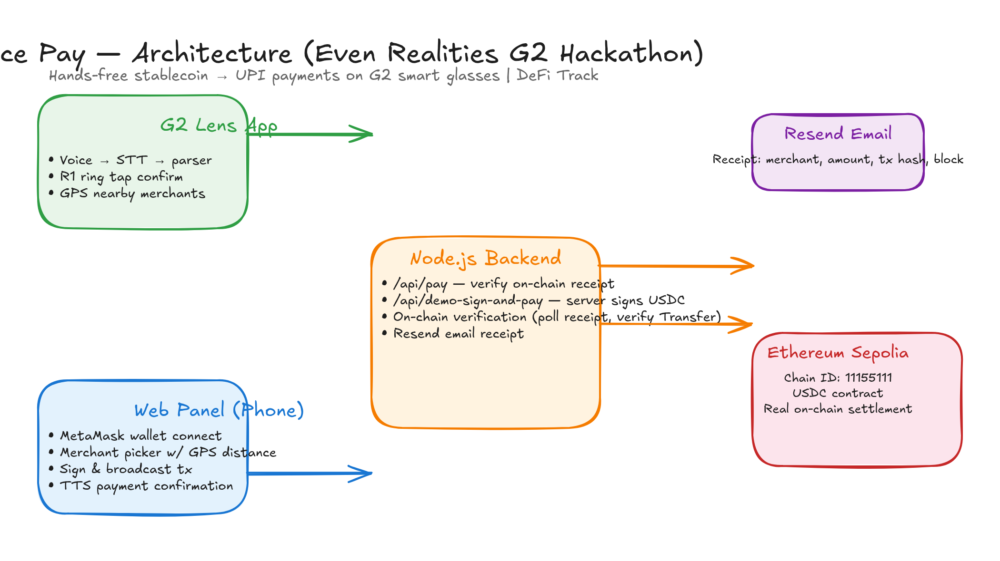

# Glance Pay

### Web panel + API: https://glance-pay-api.onrender.com

### G2 lens app: https://glance-pay-g2.onrender.com

---

## Architecture



**Flow:** G2 Lens App (voice + ring) → Web Panel (wallet + TTS) → Node Backend (on-chain verify + email) → Ethereum Sepolia (USDC) → Resend (receipt)

---

## Quick Start

```bash
# 1. Configure environment
cp .env.example .env
# Edit .env with: RESEND_API_KEY, PAYOUT_EMAIL_TO, PAYOUT_TREASURY_ADDRESS, DEMO_WALLET_PRIVATE_KEY

# 2. Start backend (port 8787)
node apps/glance-pay/server/server.mjs

# 3. Open web panel
# http://127.0.0.1:8787

# 4. (Optional) Build G2 app for Even Hub Simulator
cd apps/glance-pay-g2 && npm install && npm run build
# Serve dist/ and point simulator at it
```

---

## Project Structure

```
apps/
├── glance-pay/                 # Web panel + backend
│   ├── web/                    # Single-page console (HTML/CSS/JS)
│   │   ├── index.html
│   │   ├── app.js              # Wallet, payments, admin, TTS, GPS
│   │   └── styles.css
│   └── server/
│       └── server.mjs          # Node HTTP + ethers v6 + Resend
│
├── glance-pay-g2/              # Even Hub G2 lens app
│   ├── src/main.ts             # Lens UI, voice parser, ring input, GPS
│   ├── app.json                # Manifest (permissions, SDK 0.0.16)
│   ├── index.html
│   ├── vite.config.ts
│   └── test/parser.test.ts     # 18 voice parser tests
```

---

## Features

### G2 Lens App (`apps/glance-pay-g2/`)
| Feature | Description |
|---------|-------------|
| **3-line monochrome lens** | 576×288 green text containers via Even Hub SDK |
| **Voice → STT → parser** | "pay 12.50 to Blue Tokai" → amount + merchant |
| **R1 ring tap confirm** | Single tap = select/confirm; double-tap = cancel |
| **GPS nearby merchants** | `navigator.geolocation` + haversine sort |
| **Smart repeat defaults** | Last payment remembered → one-tap repeat on IDLE |
| **State machine** | IDLE → LISTENING → PICK_MERCHANT → CONFIRM → PENDING → SUCCESS/FAILED |

### Web Panel (`apps/glance-pay/web/`)
| Feature | Description |
|---------|-------------|
| **MetaMask connect** | Auto-switch to Ethereum Sepolia (chain 11155111) |
| **Merchant picker w/ distance** | GPS-sorted dropdown with "XXXm / Y.Ykm" labels |
| **Amount → USDC preview** | Live INR → USDC conversion (1 USDC ≈ ₹83) |
| **Sign & broadcast** | Browser wallet signs real USDC `transfer()` |
| **TTS confirmation** | "Payment of rupees 12.50 to Café X confirmed" |
| **Admin dashboard** | Onboard merchants (name, lat/lng, UPI URI, category) |
| **Payment history** | Verified on-chain receipts with Etherscan links |

### Backend (`apps/glance-pay/server/`)
| Endpoint | Purpose |
|----------|---------|
| `GET /api/chain` | Chain config (USDC address, treasury, RPC) |
| `GET/POST /api/merchants` | CRUD merchant registry (JSON file) |
| `POST /api/pay` | Verify on-chain receipt → email via Resend |
| `POST /api/demo-sign-and-pay` | Server-signs USDC with `DEMO_WALLET_PRIVATE_KEY` |
| `POST /api/stt` | Speech-to-text stub (returns demo phrase) |

**On-chain verification:**
1. Poll `eth_getTransactionReceipt` until mined
2. Confirm `status === 0x1` (success)
3. Confirm `to === USDC contract`
4. Find `Transfer` event: `from=payer`, `to=treasury`, `value ≥ expected`
5. Email receipt via Resend with tx hash, block, explorer link

---

## Voice Parser (18 tests ✅)

```typescript
parseVoice("pay 12.50")                    // { amount: 12.5 }
parseVoice("pay twelve fifty")             // { amount: 12.5 }
parseVoice("pay one hundred fifty")        // { amount: 150 }
parseVoice("pay 200 to Blue Tokai")        // { amount: 200, merchant: "Blue Tokai" }
parseVoice("pay 50 rupees")                // { amount: 50 }
parseVoice("pay 10 dollars")               // { amount: 10 }
parseVoice("pay 501")                      // throws ParseError (>500 limit)
```

Run: `cd apps/glance-pay-g2 && npm test`

---

## Demo Video

[Glance Pay G2 Demo (≤3 min)](report/glance-pay-g2-final.mp4) — narrated simulator walkthrough showing:
1. **Intro** — G2 constraints & Glance Pay concept
2. **Voice input** — "pay 12.50 to Blue Tokai"
3. **Nearby merchants** — GPS-sorted picker on lens
4. **Confirm** — R1 ring tap to sign
5. **On-chain** — Real Sepolia USDC transfer
6. **Receipt** — Verified + emailed + spoken on phone
7. **Smart defaults** — Repeat payment in one glance

---

## Hackathon Submission Checklist

- [x] Public GitHub repo with README
- [x] Demo video ≤3 min (simulator)
- [x] Description: problem, audience, how it works, track (DeFi)
- [x] Feature requests for APIs used (up to 5)
- [ ] `.ehpk` package (optional — via `@evenrealities/evenhub-cli`)

---

## Feature Requests for APIs Used

1. **Even Hub SDK** — Expose `OsEventTypeList` and `EventSourceType` as typed enums (currently minified)
2. **Even Hub SDK** — Document `audioControl(source)` return type & error codes
3. **Even Hub Simulator** — Headless/CLI mode for CI video capture
4. **Circle Testnet Faucet** — API endpoint for automated test-USDC funding
5. **Resend** — Webhook for delivery confirmation (receipt → UPI payout trigger)

---

## License

MIT — Testnet only. No real funds. Built for the Even Realities × TVM Ventures × Daos Hub "Heads Up" Hackathon (Nov 23–29, 2026).

---

*Author: Nikhil Kottoli — <nikhilkottoli2005@gmail.com>*
